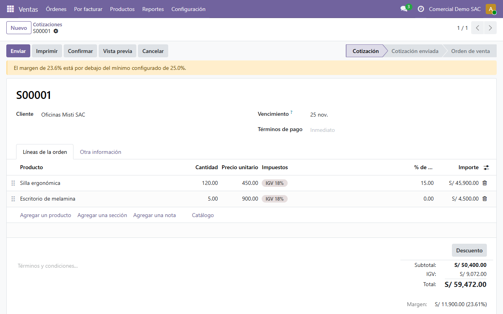
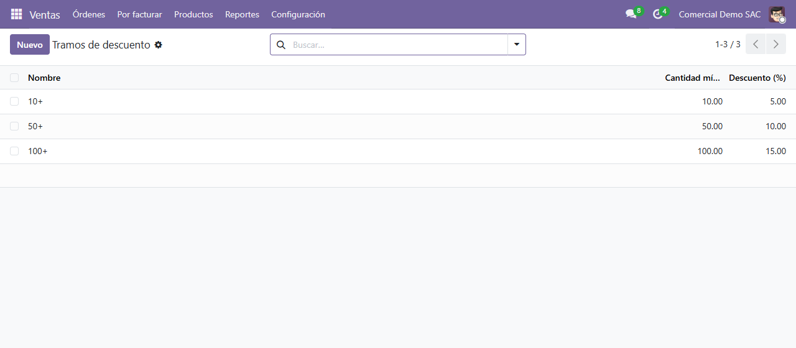
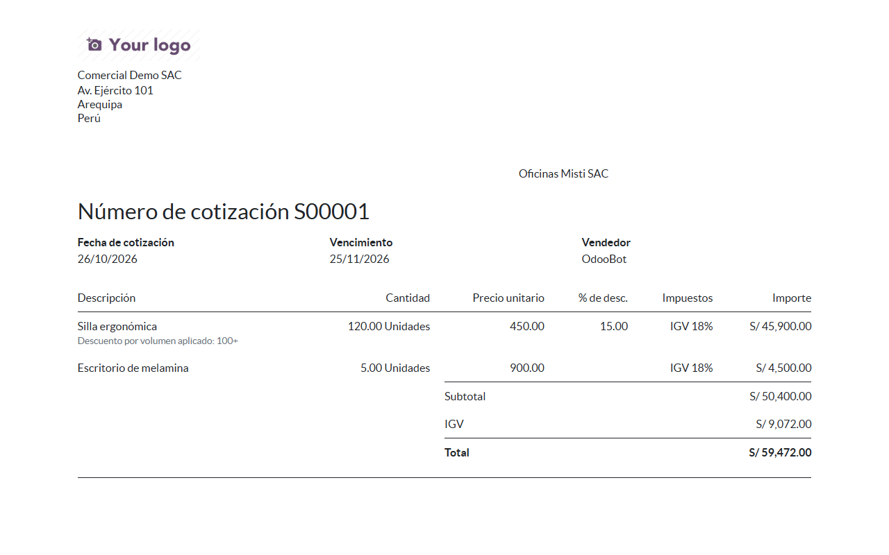

# sale_tiered_pricing

[](https://github.com/sebpost2/sale_tiered_pricing/actions/workflows/tests.yml)

**20 passing tests.** An Odoo 19 addon that applies volume discount tiers to
quotation lines automatically, flags quotations whose aggregate margin falls
below a configurable minimum, and extends the quotation PDF to show the
applied tier.

## What it does

- **Volume discount tiers** (`sale.pricing.tier`): a global, ordered ladder
  of quantity thresholds and discount percentages. Sales, Configuration,
  Pricing Tiers.
- **Automatic discounting**: each quotation line's quantity is matched
  against the tier ladder and the discount is applied to Odoo's native
  `discount` field — no parallel pricing mechanism. Installing the module turns on
  Settings, Sales, Discounts, so the discount column shows.
- **Margin guard**: a configurable minimum margin percentage (Settings,
  Sales) is checked against the quotation's aggregate margin, computed by
  Odoo's own `sale_margin` module. Quotations below the minimum show a
  warning banner. The guard flags — it never blocks saving.
- **Quotation PDF**: shows which tier was applied per line.
- **In Spanish too**: `i18n/es.po`, with the Latin American wording of
  Odoo's sales app, so a Peruvian (`es_PE`) user sees the module in
  Spanish. The margin warning is built when read, in the reader's language.





*Screenshots in Spanish (Peru), from the demo data: fictitious companies and prices.*

## Design decision: why tiers live on their own model

Volume discounts are usually negotiated at the company level — "10 or more
gets 5% off" — not configured per product. Putting tiers on their own model
(`sale.pricing.tier`) instead of as fields on `product.template` keeps the
discount ladder in one place, editable without touching every product, and
keeps `sale.order.line`'s job limited to *matching* a tier rather than
*defining* one.

## Running it

```bash
docker compose up -d
docker compose exec odoo odoo -d sale_tiered_pricing -i sale_tiered_pricing --with-demo --db_host=db --db_user=odoo --db_password=odoo --stop-after-init
```

Then open `http://localhost:8069` (user `admin`, password `admin`).
`--with-demo` loads an example: three tiers (10+, 50+, 100+), a 25% minimum
margin, and a quotation for Oficinas Misti SAC where 120 chairs reach the
15% tier and pull the whole quote to a 23.6% margin, so the warning shows.
Drop the flag for an empty database.

## Running the tests

```bash
docker compose exec odoo odoo -d sale_tiered_pricing_test -i sale_tiered_pricing --test-enable --test-tags /sale_tiered_pricing --stop-after-init --db_host=db --db_user=odoo --db_password=odoo
```

CI runs them on every push against the stock `odoo:19` image, once without
and once with demo data.

## Scope

Deliberately out of scope: multi-currency tier thresholds, per-product or
per-category tier scoping (tiers are global), and blocking save when the
margin guard triggers.
